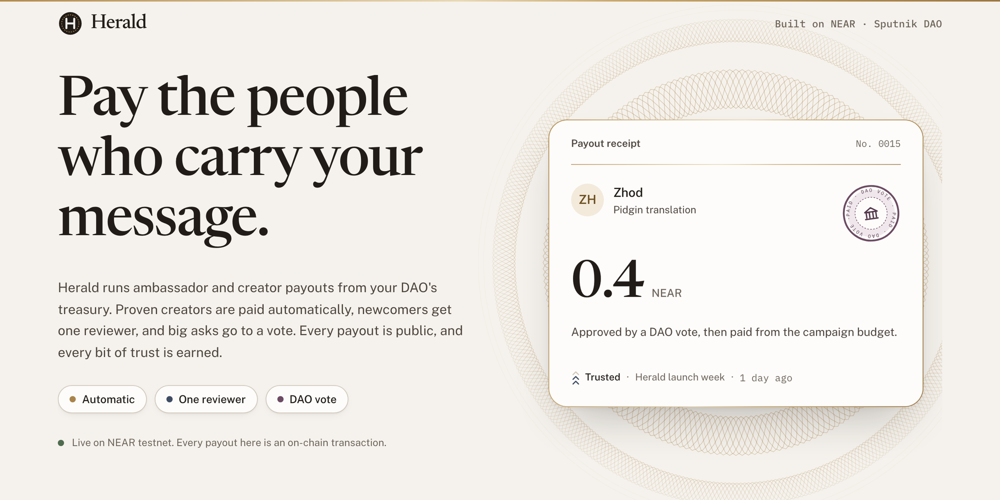
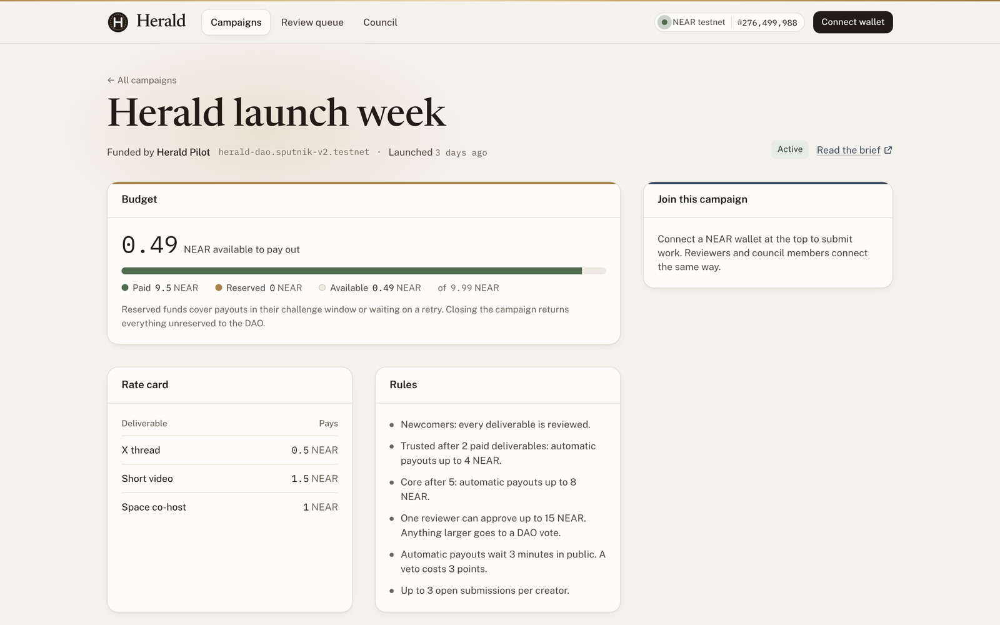
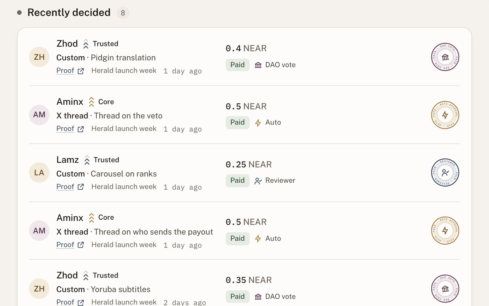
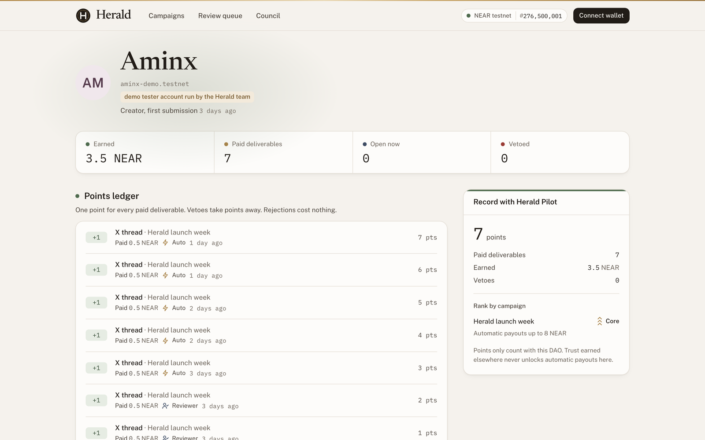
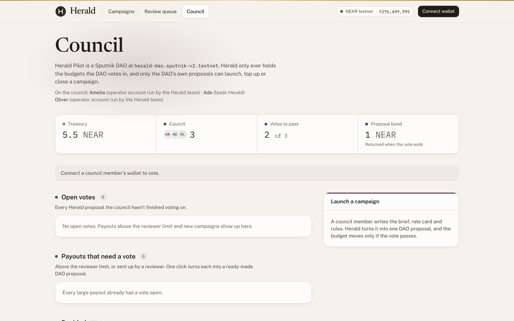

<a href="https://herald.cash"></a>

<p align="center">
  <a href="https://github.com/adexyz0x/herald/actions/workflows/ci.yml"></a>
  <a href="https://herald.cash"></a>
  <a href="https://testnet.nearblocks.io/address/herald.testnet"></a>
  <a href="https://x.com/heraldcash"></a>
  <a href="https://nearhackathon.com"></a>
  <a href="LICENSE"></a>
</p>

<p align="center">
  <a href="#live-on-near-testnet">Live on testnet</a> ·
  <a href="#demo-test-on-testnet">Demo test</a> ·
  <a href="#try-it-locally-in-five-minutes">Try it locally</a> ·
  <a href="#tests">Tests</a> ·
  <a href="#how-it-fits-together">How it fits together</a> ·
  <a href="#security">Security</a> ·
  <a href="docs/DESIGN.md">Design</a>
</p>

# Herald

**Pay the people who carry your message.**

Herald runs ambassador and creator payouts from a DAO's treasury on NEAR. The DAO funds a campaign once with a rate card. After that, every payout takes the cheapest route the creator has earned:

| Route | Who decides | When |
| --- | --- | --- |
| Automatic | The clock | Trusted and Core creators, rate-card work within their limit. Paid after a short public window in which any reviewer can veto. |
| One reviewer | A reviewer the DAO appointed | Newcomers, custom amounts, anything above a creator's automatic limit. |
| DAO vote | The council | Anything above the reviewer limit, or anything a reviewer sends up. Herald writes the Sputnik proposal; the DAO votes and pays. |

Trust is earned one DAO at a time. Every paid deliverable adds a point with that DAO, enough points make a creator Trusted and then Core, and a veto takes points away. Trust earned in one community never unlocks automatic payouts in another.

Built for the [NEAR HACKATHON](https://nearhackathon.com), Social Money track. Works with any Sputnik DAO, including Trezu treasuries.

<table>
  <tr>
    <td width="50%"><a href="https://herald.cash/#/campaigns/0"></a><br><sub><b>Campaign.</b> The budget the DAO voted in, the rate card and the rules.</sub></td>
    <td width="50%"><a href="https://herald.cash/#/review"></a><br><sub><b>Review queue.</b> Every decision is public, stamped with the route that paid it.</sub></td>
  </tr>
  <tr>
    <td width="50%"><a href="https://herald.cash/#/creators/aminx-demo.testnet"></a><br><sub><b>Creator.</b> One point per paid post, and the rank it earns with this DAO.</sub></td>
    <td width="50%"><a href="https://herald.cash/#/council"></a><br><sub><b>Council.</b> The DAO's treasury, its members and every open vote.</sub></td>
  </tr>
</table>

## Why

Every crypto project runs an ambassador or creator program, and paying people is the slow part:

- Work is tracked in a spreadsheet or a Discord channel.
- Every payout waits for multisig signers or a treasury vote, so a $50 thread waits as long as a $5,000 grant.
- Signers either approve batches they never read or become the bottleneck, and creators wait weeks asking "wen payment".
- A creator's track record doesn't travel, so they start from zero with every new project.

A treasury like Sputnik DAO or Trezu keeps the money safe and runs the votes. It isn't built to pay dozens of people every week. Herald does that part, and the DAO stays in charge of the money.

## Live on NEAR testnet

- **App:** https://herald.cash (connect a [Meteor](https://wallet.meteorwallet.app) wallet switched to Testnet)
- **Contract:** [`herald.testnet`](https://testnet.nearblocks.io/address/herald.testnet)
- **Pilot DAO:** [`herald-dao.sputnik-v2.testnet`](https://testnet.nearblocks.io/address/herald-dao.sputnik-v2.testnet), created through NEAR's Sputnik factory. Its council is Ade, who leads the project, plus two operator accounts the Herald team runs for the pilot (`oliver-herald`, `amelia-herald`). A proposal passes with 2 of 3 votes.
- **Campaign:** "Herald launch week", launched by a DAO vote ([brief](https://herald-near.pages.dev/briefs/launch-week.html)).

## Demo test on testnet

Herald hasn't paid real creators yet. To test the whole program end to end, the Herald team ran the launch week campaign on testnet from 3 to 5 November with three demo tester accounts: `aminx-demo`, `lamz-demo` and `zhod-demo`. Their profiles say they are demo accounts, and every proof link opens a [demo post](https://herald-near.pages.dev/demo/posts) marked as a demo. Reviews came from the operator account `amelia-herald`, and council votes from `amelia-herald` and `oliver-herald`.

Every step below is a real transaction, readable from `herald.testnet` (`get_campaign_submissions`, `get_reputation`) and from the DAO's proposals.

| Route | Payouts | Test NEAR | Decided by |
| --- | --- | --- | --- |
| One reviewer | 7 | 3.25 | `amelia-herald`, a reviewer the DAO appointed |
| Automatic | 5 | 2.5 | The clock, after a 3-minute public window |
| DAO vote | 4 | 3.75 | The DAO's council, 2 of 3 votes each time |
| **Total** | **16** | **9.5** | |

What the test showed:

- **Ranks are earned one payout at a time.** Aminx's first two threads went to a reviewer. After 2 paid posts Aminx was Trusted, and every thread after that paid automatically. After 5, Aminx was Core. Lamz ended on Core too, and Zhod on Trusted.
- **Custom amounts always get a reviewer.** Lamz's infographic and carousels had custom amounts, so a reviewer approved each one, even after Lamz was Trusted.
- **A reviewer can hand a payout to the DAO.** A reviewer sent Zhod's custom requests up. Each one became a Sputnik proposal, and the DAO paid it when two of the three council members voted yes.
- **The DAO controls the money.** The council launched the campaign with 8 NEAR and topped it up twice with 1 NEAR, each time by a vote. All 7 proposals (the launch, two top-ups and four payouts) passed 2 of 3. Of the 9.99 NEAR budget (a little goes to storage), 9.5 is paid and about 0.49 is left. It goes back to the DAO when the campaign closes.
- **No veto was confirmed on testnet.** In the demo video a reviewer opens the Veto dialog and cancels it. Vetoes, bans and failed-transfer rollbacks are covered by the [contract tests](#tests) instead.

<details>
<summary>Every payout in the test</summary>

| # | Creator | Work | Test NEAR | Rank when sent | Route | Paid |
| --- | --- | --- | --- | --- | --- | --- |
| 0 | Lamz | [Thread on how Herald pays ambassadors](https://herald-near.pages.dev/demo/posts#lamz-thread) (X thread) | 0.5 | Newcomer | Reviewer | 3 Nov |
| 1 | Aminx | [Why ambassador payouts are broken](https://herald-near.pages.dev/demo/posts#aminx-thread-1) (X thread) | 0.5 | Newcomer | Reviewer | 3 Nov |
| 2 | Aminx | [Three routes, one treasury](https://herald-near.pages.dev/demo/posts#aminx-thread-2) (X thread) | 0.5 | Newcomer | Reviewer | 3 Nov |
| 3 | Zhod | [Yoruba translation of the launch brief](https://herald-near.pages.dev/demo/posts#zhod-translation) (custom amount) | 2 | Newcomer | DAO vote | 3 Nov |
| 4 | Aminx | [Paid automatically once Trusted](https://herald-near.pages.dev/demo/posts#aminx-thread-3) (X thread) | 0.5 | Trusted | Automatic | 3 Nov |
| 5 | Lamz | [Thread on who approves a payout](https://herald-near.pages.dev/demo/posts.html#lamz-thread-2) (X thread) | 0.5 | Newcomer | Reviewer | 4 Nov |
| 6 | Lamz | [Infographic of the three payout routes](https://herald-near.pages.dev/demo/posts.html#lamz-infographic) (custom amount) | 0.75 | Trusted | Reviewer | 4 Nov |
| 7 | Aminx | [Thread on the challenge window](https://herald-near.pages.dev/demo/posts.html#aminx-thread-4) (X thread) | 0.5 | Trusted | Automatic | 4 Nov |
| 8 | Zhod | [Yoruba voice-over of the launch thread](https://herald-near.pages.dev/demo/posts.html#zhod-voiceover) (custom amount) | 1 | Newcomer | DAO vote | 4 Nov |
| 9 | Aminx | [Thread on how ranks are earned](https://herald-near.pages.dev/demo/posts.html#aminx-thread-5) (X thread) | 0.5 | Trusted | Automatic | 4 Nov |
| 10 | Lamz | [Payout carousel](https://herald-near.pages.dev/demo/posts.html#lamz-carousel) (custom amount) | 0.25 | Trusted | Reviewer | 4 Nov |
| 11 | Zhod | [Yoruba subtitles](https://herald-near.pages.dev/demo/posts.html#zhod-subtitles) (custom amount) | 0.35 | Trusted | DAO vote | 4 Nov |
| 12 | Aminx | [Thread on who sends the payout](https://herald-near.pages.dev/demo/posts.html#aminx-thread-6) (X thread) | 0.5 | Core | Automatic | 5 Nov |
| 13 | Lamz | [Carousel on ranks](https://herald-near.pages.dev/demo/posts.html#lamz-carousel-2) (custom amount) | 0.25 | Trusted | Reviewer | 5 Nov |
| 14 | Aminx | [Thread on the veto](https://herald-near.pages.dev/demo/posts.html#aminx-thread-7) (X thread) | 0.5 | Core | Automatic | 5 Nov |
| 15 | Zhod | [Pidgin translation](https://herald-near.pages.dev/demo/posts.html#zhod-pidgin) (custom amount) | 0.4 | Trusted | DAO vote | 5 Nov |

</details>

## Try it locally in five minutes

You need Rust (via [rustup](https://rustup.rs); the toolchain version is pinned in `contract/rust-toolchain.toml`), [`cargo-near`](https://github.com/near/cargo-near) 0.22 and Node 22 or newer.

```bash
cd contract && cargo run --example demo
```

This starts a private NEAR chain, deploys Herald and a real Sputnik DAO v2 build, seeds a fictional DAO called Beacon Collective with three campaigns and a history of payouts, and writes `web/public/local-demo.json` for the app. Leave it running. In a second terminal:

```bash
cd web && npm install && npm run dev
```

Open http://localhost:5173 and use **Viewing as** in the header to act as anyone in the demo. Each person signs with their own key on the local chain.

| Do this | See this |
| --- | --- |
| As **Cleo** (creator), open *Q4 ambassador push* and submit an X thread | The form says it will pay automatically; the row shows "Pays in 03:00" |
| As **Marco** (reviewer), open the Review queue and veto that thread | Cleo loses 3 points, visible on her profile's points ledger |
| As **Kemi** (reviewer), approve Dami's pending thread | Dami is paid at once and the payout is stamped with the reviewer seal |
| As **Oliver** (council), open Council and approve Sol's 25 NEAR request | The DAO executes the proposal and pays Sol; it moves to Decided |
| As **Amelia** (council), click Start a proposal, then Fill an example, then File the proposal; vote yes as Amelia and Ade | The new campaign goes live with its budget |

The home page also tells the whole flow as a scroll story: one creator's path through the three routes.

## Tests

```bash
cd contract && cargo test
```

- 26 unit tests for routing, tiers, budgets, storage accounting, vetoes, bans and payout rollbacks.
- 2 integration tests that run the whole program in a sandbox against the real Sputnik DAO v2 builds deployed on mainnet and testnet (`contract/tests/res`): launch by DAO vote, reviewer payouts, earning Trusted, an automatic payout with its challenge window, a veto, a DAO-vote payout, closing a campaign and refunding the treasury.

```bash
cd web && npm run typecheck && npm run build
```

[GitHub Actions](.github/workflows/ci.yml) runs all of this on a clean machine for every push, along with `cargo fmt --check` and `cargo clippy`.

`npm audit` in `web/` still lists warnings from the wallet libraries, not from Herald's own code:

- **`decode-uri-component` (high, denial of service).** It comes in through the Meteor wallet SDK's `query-string` 7. The fixed version is an ES module that `query-string` 7 can't load, and even the latest Meteor SDK pins these versions. Only `query-string`'s parsing runs the affected code, and neither Herald nor the Meteor SDK calls it.
- **`elliptic` (low).** It comes in through `@near-js/crypto`, and no fixed version exists yet.

The Meteor SDK's `nanoid` is pinned to the fixed 5.x release in `web/package.json`.

## How it fits together

```
DAO treasury ── council vote ──▶ campaign budget (held by Herald) ──▶ creator's wallet
      ▲                                    │
      └────────── unspent budget on close ─┘
```

- **The DAO only ever moves a capped budget.** `create_campaign` is called by the DAO through a Sputnik `FunctionCall` proposal, with the budget attached. Top-ups and closing work the same way.
- **Payouts go straight to the creator.** Herald transfers from the campaign budget to the creator's account. A failed transfer rolls back to "payout to retry" and anyone can retry it.
- **Invariant:** reserved + paid ≤ budget for every campaign. Automatic payouts reserve their amount for the length of their public window.
- **Herald takes no fee.**
- **The contract has no admin methods.** Only a campaign's DAO can change it, and only through its own votes. On testnet the deployer account still holds its key so fixes can ship during the hackathon; for mainnet the plan is to remove that key or hand upgrades to a DAO.

The full specification, including the lifecycle, parameters and threat model, is in [docs/DESIGN.md](docs/DESIGN.md).

### Contract interface

| Who | Methods |
| --- | --- |
| A campaign's DAO | `create_campaign`, `top_up`, `update_campaign`, `close_campaign`, `dao_approve`, `dao_reject`, `dao_set_ban` |
| Creators | `submit` (rate-card line or custom amount, with a proof link) |
| Reviewers | `approve`, `reject`, `veto` (optionally as fraud, which bans), `escalate` |
| Anyone | `finalize` (after the public window), `claim` (retry a failed transfer) |
| Views | `get_campaign(s)`, `get_submission`, `get_campaign_submissions`, `get_creator_submissions`, `get_reputation`, `get_tier`, `get_dao_proposal`, `get_stats` |

Every state change emits a NEP-297 event (`standard: "herald"`).

## NEAR technology used

| What | Where |
| --- | --- |
| Sputnik DAO v2 `FunctionCall` proposals. The DAO launches, tops up and closes campaigns, and pays large requests, through its own votes. Herald writes each proposal ready to file. | `contract/src/campaign.rs`, `get_dao_proposal` in `contract/src/views.rs`, `add_proposal` and `act_proposal` in `web/src/lib/sputnik.ts` |
| A transfer with a callback. If paying a creator fails, the payout rolls back and waits for a retry. | `on_payout` in `contract/src/payout.rs` |
| Storage staking. Each call charges the storage it adds to whoever made it and refunds the rest. | `settle_storage` in `contract/src/lib.rs` |
| Block time for the public window before an automatic payout. | `contract/src/submission.rs` |
| NEP-297 events for every change, so the app and any indexer can rebuild the history. | `contract/src/events.rs` |
| NEP-330 source metadata that links the deployed contract to this repo. | `contract/Cargo.toml`, built with `cargo-near` |
| `near-sdk` 5 collections (`LookupMap`, `LookupSet`). | `contract/src/lib.rs` |
| `near-workspaces` sandbox tests against the real Sputnik DAO v2 builds from mainnet and testnet. | `contract/tests/sputnik.rs` |
| NEAR Wallet Selector with Meteor and Intear. | `web/src/lib/wallet.ts` |
| `near-api-js` on the local demo chain, where each demo person signs with their own key. | `web/src/lib/signer.ts` |
| FastNEAR RPC for testnet reads. | `web/src/lib/config.ts` |

## Security

| Risk | What stops it |
| --- | --- |
| Someone other than the DAO changes a campaign | Every rule-changing method checks that the caller is the campaign's DAO, which acts only through its own votes. The contract has no admin methods. |
| The budget is overspent | `reserved + paid ≤ budget` is checked on every approval. |
| Fake accounts farm trust | New accounts are Newcomers, and every Newcomer payout needs a reviewer the DAO appointed. |
| A trusted creator submits junk | Automatic payouts wait in a public window where any reviewer can veto. A veto costs points, and a fraud veto bans. Automatic limits are small. |
| A reviewer pays a friend, or themselves | Reviewers can't decide on their own work, each approval is capped, and every decision is public and named. The DAO can remove a reviewer. |
| Trust from one DAO is used in another | Reputation is kept per DAO. |
| Spam | Each campaign caps the open submissions per creator (3 by default), and creators pay the storage for their own. |

Known limits: Herald doesn't check that a post exists or how it did. That is the reviewer's job, and an AI pre-check is on the list below. Payouts are in NEAR for now. The full threat model is in [docs/DESIGN.md](docs/DESIGN.md#10-threat-model).

## Repository

| Path | What's there |
| --- | --- |
| `contract/` | Rust smart contract (near-sdk 5.30): campaigns, submissions, payouts, views, validation |
| `contract/tests/` | Sandbox integration tests against real Sputnik builds |
| `contract/examples/demo.rs` | The local demo: chain, contracts and seeded program |
| `web/` | React 19, Tailwind CSS 4 and Motion app; local demo and testnet builds |
| `scripts/testnet.sh` | Testnet operations: deploy, create and fund the DAO, propose campaigns, vote, review |
| `scripts/publish-testnet.sh` | Builds the testnet app and publishes it, refusing to ship if a key slips in |
| `pilot/` | The launch week campaign definition |
| `docs/DESIGN.md` | Design and specification |
| `docs/assets/` | The banner and app screenshots in this README |
| `.github/workflows/ci.yml` | Tests and builds on every push |

## Next

- Stablecoin budgets (USDC via NEP-141).
- Gasless submissions and claims for creators through a meta-transaction relayer.
- An AI pre-check on NEAR AI Cloud that reads the submitted post and gives reviewers a second opinion.
- Reputation export, so other programs can read a creator's verified history.
- Mainnet, starting with DAOs that already pay ambassadors from a Sputnik or Trezu treasury.

## Built by

[Ade](https://x.com/adefola_), a former Arbitrum ambassador who works on user acquisition at Immutable and runs creator campaigns.

Follow the project on X: [@heraldcash](https://x.com/heraldcash).

## License

MIT, see [LICENSE](LICENSE). The Sputnik DAO wasm files used in tests are MIT licensed by their authors; see `contract/tests/res/README.md`.
