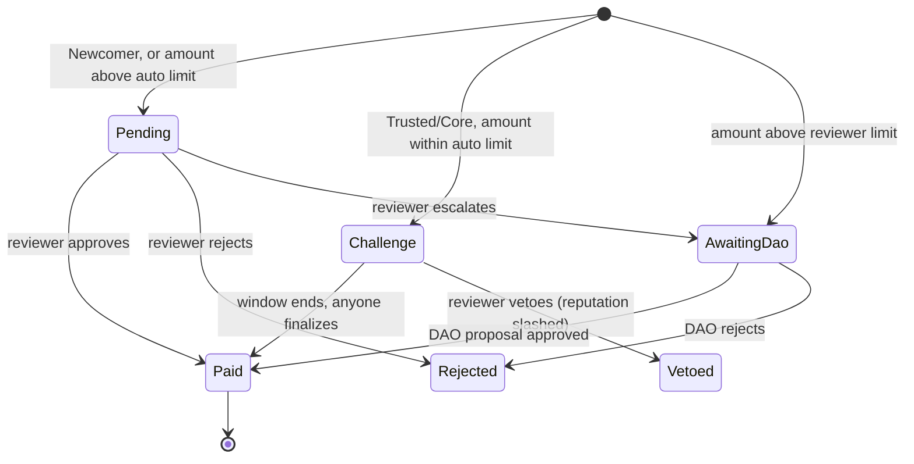

# Herald: design

*Pay the people who carry your message.*

Herald pays ambassadors and creators from a community treasury. The DAO funds a campaign once. After that, every payout is approved by the cheapest route the creator has earned: automatic for proven creators, one reviewer for everyone else, and a full DAO vote for anything large. Every approval, payout and reputation point is public and traceable on NEAR.

Status: design for NEAR HACKATHON (Social Money track). Testnet only.

---

## 1. The problem

Every crypto project runs an ambassador or creator program. The payout side looks the same everywhere:

- Work is tracked in a spreadsheet or a Discord channel.
- Each payout needs a multisig signature or a treasury vote, so a $50 thread waits as long as a $5,000 grant.
- Signers rubber-stamp batches they never read, or they become the bottleneck.
- Creators can't prove their track record, so they start from zero with every new project.

A treasury like Sputnik DAO or Trezu solves custody and approvals. It doesn't solve the volume. Herald is what a community does *with* its treasury when it pays dozens of people every week.

## 2. What exists vs what we add

| Need | Sputnik DAO / Trezu today | Herald adds |
|---|---|---|
| Custody of funds | Yes (the DAO account holds the treasury) | Nothing. The DAO stays the only governor and moves a capped budget into a campaign with one proposal |
| Approving a payment | One proposal per payment, voted by a role (e.g. Trezu's Finance role) | Three routes by risk: automatic with a challenge window, one reviewer, or a normal DAO proposal |
| Bulk payments | CSV upload, still one vote for the whole batch | Each payout approved individually, in parallel, by the route it qualifies for |
| Who can approve | Roles in the DAO policy | Reviewers appointed per campaign by DAO proposal, with a hard per-approval limit |
| Track record | None | Reputation per creator, scoped to each DAO, with every point linked to a paid submission |
| Fraud response | Reject a proposal | Veto within the challenge window, slash reputation, ban, all on-chain and reversible by the DAO |

Trezu treasuries are Sputnik DAO accounts (`*.sputnik-dao.near`), so Herald works with both. The only requirement is that the proposer's role may create `call` proposals.

## 3. Actors

| Actor | Who | Can do |
|---|---|---|
| DAO | A Sputnik DAO account (the `predecessor` of `create_campaign`) | Create and fund campaigns, change rules and reviewers, top up, close, approve or reject anything, ban or unban creators. Everything goes through the DAO's own proposals and votes |
| Reviewer | Accounts the DAO lists on a campaign (max 10) | Approve or reject submissions up to the reviewer limit, veto automatic payouts during the challenge window, flag fraud, escalate to the DAO |
| Creator | Any NEAR account | Submit work, claim payouts. Can't review their own work |
| Anyone | Any account, including a bot | Finalize an automatic payout after its challenge window ends. Read everything |

There is no admin key. The contract has no owner and no upgrade method. Every privileged action checks that the caller is the campaign's DAO or one of its reviewers.

## 4. Campaign lifecycle

1. A DAO member proposes **Launch campaign** in the Herald app. The app creates a standard Sputnik `FunctionCall` proposal that calls `create_campaign` with the budget attached as deposit.
2. The council votes in Sputnik, Trezu or the Herald app. On approval the DAO executes the call and the campaign is live and funded.
3. Creators submit work against the campaign's rate card.
4. The DAO can top up, change rules or reviewers, or close the campaign at any time through further proposals. Closing returns all unreserved budget to the DAO.

## 5. Submission lifecycle

A payout that fails on-chain (for example, the receiver account was deleted) is rolled back to `Approved` and can be retried with `claim`.

## 6. Approval routes

The route is decided when work is submitted, from the creator's tier in this DAO and the amount.

| Creator tier | Amount ≤ auto limit for tier | Amount ≤ reviewer limit | Amount > reviewer limit |
|---|---|---|---|
| Newcomer | Pending (one reviewer) | Pending (one reviewer) | AwaitingDao |
| Trusted | Challenge (automatic) | Pending | AwaitingDao |
| Core | Challenge (automatic) | Pending | AwaitingDao |

- Custom amounts (not on the rate card) always go to a reviewer or the DAO, never the automatic route.
- A reviewer can always escalate a Pending submission to the DAO instead of deciding alone.
- The DAO can approve or reject any submission in any open state.

## 7. Reputation and tiers

- Reputation is kept **per DAO**: `(dao, creator) → record`. Trust earned with one community never grants automatic payouts in another. A creator's public profile still shows their full history across all DAOs, as a portable track record.
- **+1 point** for every paid submission. The record keeps the list of submission IDs behind every point.
- **Veto** during the challenge window: payout cancelled and **−3 points** (configurable), floored at 0.
- **Fraud flag** on a veto: payout cancelled, points slashed, and the creator **banned** from this DAO's campaigns. Only the DAO can unban.
- Tiers per campaign, from the creator's points in that DAO: **Newcomer** (below `trusted_after`, default 3), **Trusted** (from 3), **Core** (from `core_after`, default 10).

## 8. Money flow and invariants

- The campaign budget is the deposit attached by the DAO, minus a fixed storage reserve.
- Approving reserves funds. Paying moves them from reserved to paid. A veto, rejection or failed transfer releases them.
- **Invariant:** `reserved + paid ≤ budget` at all times, so a campaign can never pay out more than the DAO funded.
- Payouts are native NEAR transfers with a callback. On failure, state is reverted and the payout is retryable.
- Closing a campaign returns `budget − reserved − paid` to the DAO. Payouts already in their challenge window can still be finalized from the reserved funds.
- Creators pay the storage for their own submissions (the attached deposit is measured and the excess refunded). This makes spam cost the spammer, not the treasury.

## 9. Parameters

| Parameter | Default | Demo value |
|---|---|---|
| `trusted_after` | 3 paid submissions | 2 |
| `core_after` | 10 paid submissions | 4 |
| Auto limit, Trusted | 10 NEAR | 10 NEAR |
| Auto limit, Core | 50 NEAR | 50 NEAR |
| Reviewer limit | 100 NEAR | 100 NEAR |
| Challenge window | 24 hours | 3 minutes |
| Max open submissions per creator per campaign | 3 | 3 |
| Reputation slash on veto | 3 points | 3 points |

All parameters are set by the DAO when the campaign is created and can only be changed by another DAO proposal.

## 10. Threat model

| Attack | What stops it |
|---|---|
| Sybil accounts farm trust | New accounts are Newcomers, and every Newcomer payout needs a human reviewer the DAO appointed. Trust is earned only through approved work in that DAO |
| Creator spams submissions | Max 3 open submissions per campaign, and the creator pays the storage for each one |
| Trusted creator submits junk to collect automatic payouts | Every automatic payout waits in a public challenge window. Any reviewer can veto, which slashes reputation and can ban. Automatic limits are small by design |
| Reviewer approves a friend's junk | Reviewers can't approve their own work, every approval is public and named, single approvals are capped at the reviewer limit, and the DAO can remove the reviewer and ban the creator |
| Reviewer griefs a good creator with vetoes | Vetoes are public with a reason, and the DAO can restore reputation (unban) and remove the reviewer |
| Budget drained beyond what the DAO approved | `reserved + paid ≤ budget` is enforced on every approval |
| Trust from a fake DAO used against a real one | Reputation is scoped per DAO |
| Someone other than the DAO changes the rules | Every privileged method checks the caller is the campaign's DAO, which acts only through its own votes |
| Payout sent to an account that no longer exists | The transfer callback reverts the payout and keeps the funds reserved for a retry |

Known limits, stated plainly:

- Herald doesn't verify that a post actually exists or how it performed. That is the reviewer's job. An AI pre-check is on the roadmap.
- A colluding majority of reviewers can approve bad work up to their limits. The DAO is the backstop.
- Payouts are in NEAR. Stablecoin (NEP-141) budgets are next on the roadmap.

## 11. Contract interface

Change methods:

| Method | Caller | Notes |
|---|---|---|
| `create_campaign(title, brief_url, rate_card, reviewers, rules)` | DAO | Payable. Deposit funds the budget |
| `top_up(campaign_id)` | DAO | Payable |
| `update_campaign(campaign_id, reviewers?, rules?)` | DAO | |
| `close_campaign(campaign_id)` | DAO | Refunds unreserved budget |
| `submit(campaign_id, deliverable, proof_url, note)` | Creator | Payable (storage). `deliverable` is a rate-card index or a custom amount |
| `approve(submission_id)` / `reject(submission_id, reason)` | Reviewer | Pays immediately on approve |
| `veto(submission_id, reason, fraud)` | Reviewer | Only during the challenge window |
| `escalate(submission_id)` | Reviewer | Sends a Pending submission to the DAO |
| `dao_approve(submission_id)` / `dao_reject(submission_id, reason)` | DAO | |
| `dao_set_ban(account_id, banned)` | DAO | Scoped to the calling DAO |
| `finalize(submission_id)` | Anyone | After the challenge window |
| `claim(submission_id)` | Creator | Retries a failed payout |

Views: `get_campaign`, `get_campaigns`, `get_submission`, `get_campaign_submissions`, `get_creator_submissions`, `get_reputation(dao, account)`, `get_tier(campaign_id, account)`, `get_dao_proposal(submission_id)` (the exact Sputnik proposal to open for a DAO vote), `get_stats`.

Events follow NEP-297 (`standard: "herald"`, `version: "1.0.0"`): `campaign_created`, `campaign_updated`, `campaign_closed`, `submission_created`, `submission_approved`, `submission_rejected`, `submission_vetoed`, `submission_escalated`, `payout_paid`, `payout_failed`, `reputation_changed`.

## 12. Roadmap after the hackathon

- Stablecoin budgets (USDC via NEP-141).
- Gasless claims for creators through a meta-transaction relayer.
- An AI pre-check on NEAR AI Cloud that reads the submitted post and gives reviewers a second opinion.
- Reputation export so other programs can read a creator's verified history.
